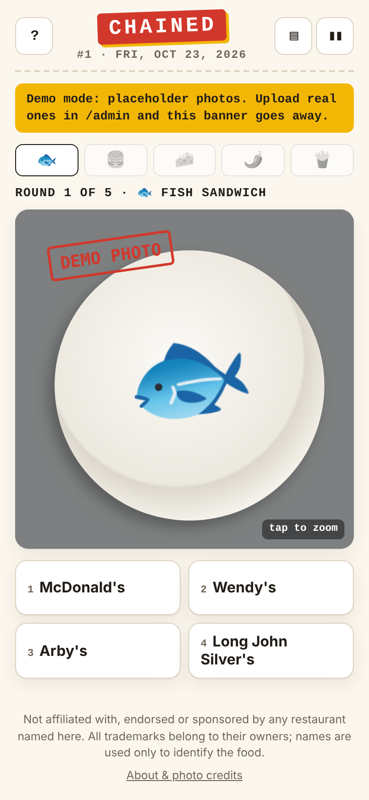
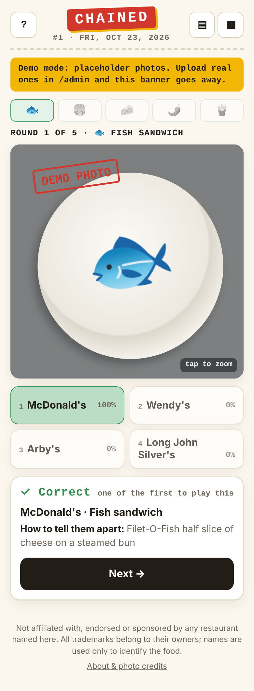
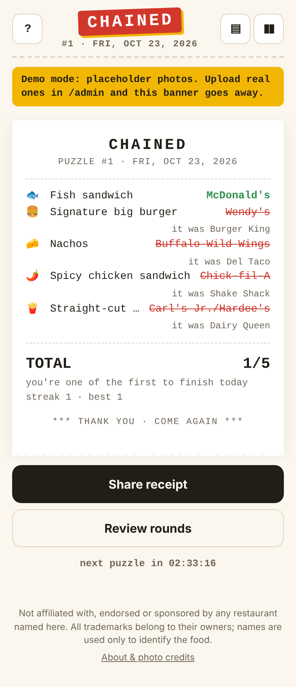

# CHAINED (working title): the daily fast-food brand guesser

Every day you get 5 photos of chain food: a pizza slice, wings, fries, a shake, a taco. Each is shown on the same plain plate with no packaging. For each one, pick which of 4 chains made it. Everyone gets the same 5. You can share your score as an emoji receipt.

| Play (phone) | Reveal | Receipt |
|---|---|---|
|  |  |  |

Admin: [dashboard](docs/screenshots/10-admin-dash.png) · [QA queue](docs/screenshots/12-admin-qa.png) · [shot list](docs/screenshots/13-admin-shots.png) · [schedule](docs/screenshots/14-admin-schedule.png) · [catalog](docs/screenshots/15-admin-catalog.png) · [dark mode, desktop](docs/screenshots/08-dark-desktop.png). These show demo placeholders, because there are no real photos yet.

## Run it on the VPS (one command, port 7090)

Needs Ubuntu 22.04 or newer: Python 3.10+ is already there, nothing to pip/npm install.

```
sudo apt install -y screen           # once
cd brand-guesser
./start.sh                           # starts (or restarts) in a detached screen session "chained"
```

It prints the play URL, the admin URL, and where the admin password is. On first run a password is generated into `var/admin_password`. Set your own with `CHAINED_ADMIN_PASSWORD=... ./start.sh`.

| Command | What it does |
|---|---|
| `./start.sh` | start / restart in `screen` (auto-restarts the server if it ever crashes) |
| `./start.sh attach` | watch it live (`Ctrl-a d` to detach again) |
| `./start.sh stop` | stop it |
| `./start.sh fg` | run in the foreground (e.g. inside a `screen` you opened yourself) |
| `tail -f var/server.log` | access log |

**Open the port:** `sudo ufw allow 7090/tcp`, plus your provider's firewall if it has one.

**Start on boot:** `crontab -e`, then add:

```
@reboot cd /path/to/brand-guesser && ./start.sh
```

**Back up** the `var/` folder: `chained.db` + `photos/` is the whole game.

```
python3 -c "import sqlite3; sqlite3.connect('var/chained.db').backup(sqlite3.connect('var/backup.db'))"
```

**HTTPS (recommended before sharing links).** Share sheets and clipboard need it on some phones. Put Caddy in front:

```
sudo apt install -y caddy
# /etc/caddy/Caddyfile
yourdomain.com {
    reverse_proxy 127.0.0.1:7090
}
sudo systemctl reload caddy
HOST=127.0.0.1 CHAINED_TRUST_PROXY=1 ./start.sh     # only reachable through Caddy now
```

## Using it

1. **Play:** `http://<server>:7090/`. Until real photos exist, every item uses a labelled **demo placeholder**, so the whole loop works on day one.
2. **Admin:** `http://<server>:7090/admin` (user `admin`). The workflow is in `docs/DATA.md` §4–5:
   - **Shot list:** what to buy next. It simulates the schedule and lists photos needed vs. owned per item, for 30/120/365 days.
   - **Upload:** works from your phone at the shoot. Pick category + brand + angle and drop the photos. The browser resizes them to 1600 px and strips EXIF/GPS, and the server strips metadata again.
   - **QA queue:** approve/reject with `A`/`R`, set difficulty with `1`–`5`, compare against other brands' photos in the same category.
   - **Schedule:** the next 14 days with answers, and the live % correct once people play. Approving, rejecting or editing the catalog automatically regenerates unplayed future days. Days already live or played never change.
   - **Catalog:** turn categories on/off, edit difficulty, menu names and "the tell" shown after each answer, mark giveaways, retire discontinued items, set a recipe-change date (older photos then stop being used), add brands.
   - **Dashboard:** counts, players per day, settings (name, demo placeholders on/off, launch date = puzzle #1).
3. **Before launch:**
   - get ≥ 120 days banked (Shot list, 120 days, gap 0);
   - turn demo placeholders off;
   - set the launch date;
   - pick a real name;
   - add HTTPS.

Test a running server end to end with `python3 tools/smoke_test.py http://localhost:7090`. It leaves test data behind, so run it on a dev copy.

## What's in here

- `start.sh`: the one launch command.
- `app/server.py`: HTTP server, public API, admin API, image hygiene.
- `app/scheduler.py`: builds each day's 5 rounds from the photo bank (rules in `docs/DATA.md` §6) and loosens them gracefully when the bank is thin.
- `app/db.py`: SQLite schema and first-run seeding from `data/catalog.json`.
- `app/static/`: the game (`index.html`, `game.js`, `style.css`) and the admin tool (`admin.*`).
- `var/` (created at runtime, git-ignored): `chained.db`, `photos/`, `admin_password`, `server.log`.
- `docs/GAME.md`: the game: rules, difficulty ramp, reveal, share format, look, modes, name shortlist.
- `docs/DATA.md`: the photo database: how many photos we need, schema, shoot protocol, QA pipeline, scheduling rules.
- `docs/BUILD.md`: stack as built, API, costs, roadmap.
- `docs/RESEARCH.md`: competitors, market, copyright/trademark, image sources, chain × menu matrix notes.
- `data/catalog.json`: seed catalog with 116 chains and 68 categories (523 brand items), with difficulty, look-alikes, giveaways and tells.
- `tools/schedule.py`: capacity simulator / shot-list planner (`--launch --plan 365`).
- `tools/smoke_test.py`: end-to-end API test.

## Headline numbers

- **Year 1 needs 1,825 photos** across ~325 items.
- **Launch needs 600** (120 days in the bank).
- **Shooting it ourselves** costs ~$1.5–2k for launch and ~$5–6k DIY for year 1.
- **Never use brand marketing photos** (`docs/RESEARCH.md` §2).
