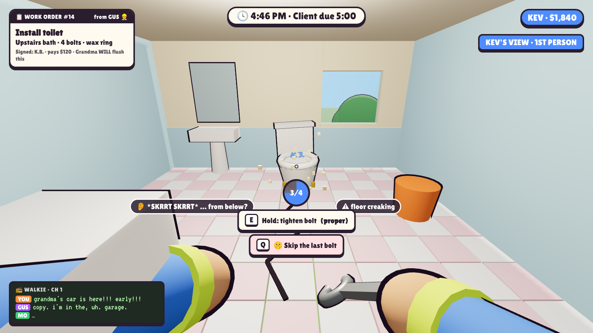
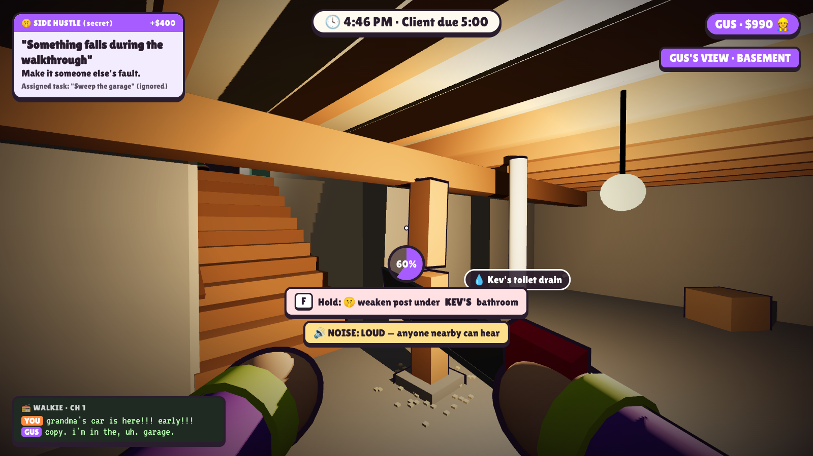
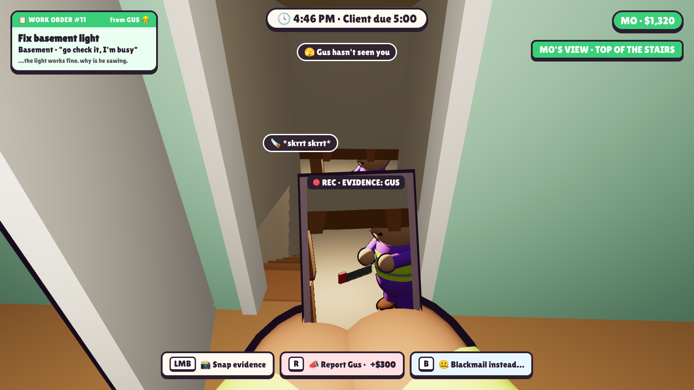
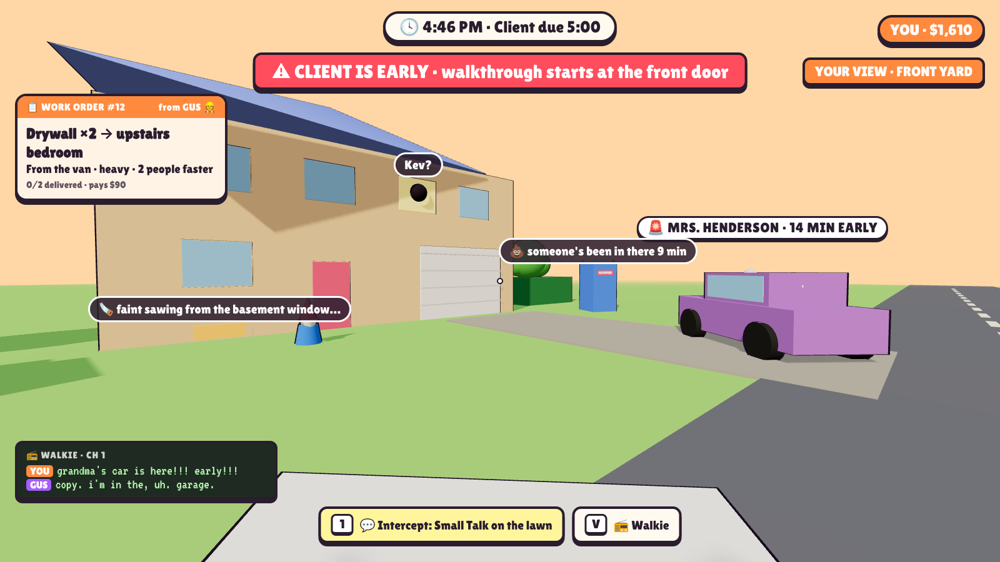
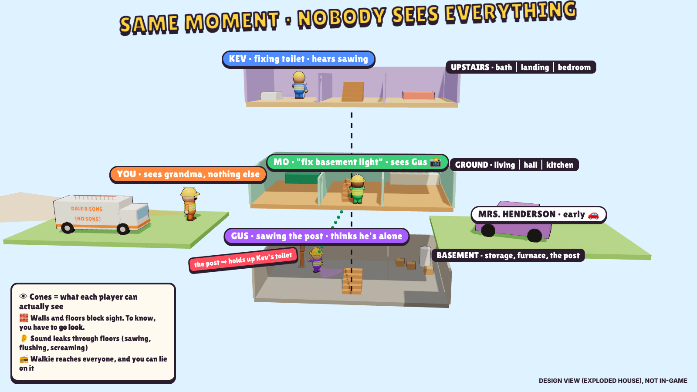

# OVER BUDGET: the explorable job site (v0.2)

> 🏠 4 contractors. 1 three-storey house. everyone has a work order on the other side of the building. you can hear sawing in the basement. gus says he's in the garage. gus is not in the garage. **OVER BUDGET**

This version replaces the "dollhouse camera where everyone sees everything" from v0.1 with **one explorable 3D house, a first-person camera for each player, and real information gaps**. It keeps the money, signed work, sabotage and the blame vote from `OVER_BUDGET.md` §10. What changes is *who knows what*.

Inspiration: office social-deduction games like *Dale & Dawson Stationery Supplies* (each player has their own first-person view of a shared office, jobs are scattered around it, and the people slacking can only get caught if someone actually sees them), mixed with Lethal Company's "split up and pray" structure.

*The five mockups show **the same moment, 4:46 PM, from four players** plus a design cutaway. Kev is installing a toilet upstairs and hears sawing below him. Gus is in the basement sawing the post that holds up Kev's bathroom, and lied on the walkie that he's "in the garage." Mo was sent to "fix the basement light," found Gus, and raised his phone to get evidence. You're outside with drywall and see Grandma's car arrive 14 minutes early.*

---

## 1. Core rule: you only know what you saw, heard or were told

| Channel | What it gives you | How it can lie to you |
|---------|-------------------|-----------------------|
| 👁 **Your eyes** | First-person view with a ~75° field of view. Walls, floors and doors block sight. | It doesn't lie, but you're usually looking at a toilet. |
| 👂 **Sound** | Noises travel through floors and walls, muffled by distance: sawing, hammering, drilling, flushing, screaming, a raccoon. You get a small directional cue ("from below"). | You know *something* is happening, not *who* is doing it. |
| 🗣 **Proximity voice** | Normal talking, only nearby. | Works only if you're in the same room. |
| 📻 **Walkie** | Push-to-talk channel that reaches everyone, anywhere. | **Anyone can say anything.** "I'm in the garage." |
| 📋 **Work-order board** | Who's assigned to what, and whether it's marked done. | "Done" is self-reported. You find out how well it was done by going to look. |
| 📸 **Phone camera** | Snap a photo to make *evidence* that holds up in the blame vote. | Photos are timestamped, so they're the only thing in the game that can't lie. |

**What changed from v0.1:** you can no longer see everyone's flaws. You only see **your own** 🤫 stickers. Other people's shoddy work stays invisible until you walk up to it and **inspect** it (hold Tab while looking). Then you can **tag** it on the shared clipboard, or keep it to yourself as leverage.

---

## 2. The map: one house, three floors, a yard

Each job is one property. Start with a single handmade house, then add a few layouts (a ranch, a McMansion, a haunted Victorian).

| Area | What's there | Why it matters |
|------|--------------|----------------|
| **Front yard + driveway** | The company **van** (materials), dumpster, porta-potty, gnome | The materials hub. Everyone passes through it. The client arrives here, so it's the early-warning post. |
| **Garage** | Tools, the breaker panel, the shop-vac (Noise Cover) | A classic fake alibi ("I'm in the garage"). Power can be cut from here, which is a sabotage *and* a prank. |
| **Ground floor** | Living room, kitchen, hallway, basement door, stairs up | Where the walkthrough starts. Busy, lots of sightlines. |
| **Upstairs** | Bathroom, bedroom, landing | Far from the van, so heavy carries take a long time. The client *always* uses this bathroom. |
| **Basement** | Furnace, water heater, support posts, storage, darkness | Few windows, one way in, loud echo. **This is where sabotage happens,** and also where you get caught. |
| **Crawlspace / attic** (stretch) | Ducts and joists, connecting rooms | Secret shortcuts. Hear everything, see nothing. |

**Sightlines are designed on purpose:**
- **Long corridors** where you can spot people from far away.
- **Blind corners** where you can't.
- **One-way windows.** The basement window lets the yard *hear* the basement but not see into it.
- **Stairs as chokepoints.** Everyone has to pass the stairwell, so it's the best spot to watch from.

---

## 3. Work orders: why you're always split up

- At the start of each job, **the Foreman** (rotating, last place gets it) assigns **work orders** on a tablet.
  - Each player gets 2–4 orders at a time, spread across the property.
  - New ones arrive as the job goes on, like "the client called: she wants a skylight."
- **An order is a trip,** for example:
  1. Get materials from the van or garage.
  2. Carry them to the room. Heavy items are slow, and two people carrying is faster.
  3. Do the task the proper way (hold E) or hack it (Q).
  4. Mark it done.
- **Bad assignments are a strategy:**
  - The Foreman can send someone to the far end of the house so they can't see what he's doing ("go fix the basement light, I'm busy").
  - The Foreman can also send someone to the wrong room on purpose.
  - Players *can* refuse or swap orders, but unfinished orders dock your pay.
- **The house as a clock:** the walkthrough happens at 5:00 *or* whenever the client reaches the front door, whichever comes first. She can arrive early. Whoever is outside is the only one who will see her coming.

---

## 4. Sabotage and getting caught

Sabotage from §10 still applies (Loosen, Swap, Forge), but now it's **physical and local**:
- **You have to be there.** Sabotaging Kev's toilet means going *to* Kev's bathroom, or to the post under it.
- **Sabotage is noisy or slow:**
  - Sawing: loud, fast.
  - Unscrewing: quiet, slow.
  - Forging a signature: silent, but you have to stand right at the work.
- **There's no "safe" indicator.** You never get told "nobody can see you." You have to check doors, listen for footsteps, and glance at the stairs.
- **Witnessing:** if someone sees you in the act, they can:
  - **📸 Snap a photo.** This is evidence for the blame vote, worth +$300 if they Report you.
  - **📣 Report immediately.** Weaker without a photo: it's your word against theirs.
  - **🤐 Blackmail.**
    - They keep the photo and send you a private demand: "do my drywall order" or "give me half your side-hustle money."
    - If you don't pay, they Report you.
    - This creates a secret partnership that's good for a betrayal later.
- **Alibis:**
  - The game quietly logs which **room** everyone was in, minute by minute.
  - During the blame vote, any player can spend a one-time **"Check the timesheet"**. It reveals one player's location at one moment, so you can disprove "I was in the garage."

---

## 5. The walkthrough, split across the house

The client walks a route (§4 in `OVER_BUDGET.md`) through **real rooms on real floors**, so the crew can't cover everything:
- **You can only defend the rooms you're in.** Everyone spreads out, guesses her path and calls it on the walkie: "SHE'S GOING UPSTAIRS. KEV, HIDE THE TOILET."
- **Spotter role:** one player follows her, does Small Talk to slow her down, and narrates on the walkie. The others run ahead and cover up.
- **Things go wrong where nobody is watching.** Sounds from rooms you're not in are part of the fun: a crash, a scream, a flush, then silence.
- **The replay helps blame land:** after the walkthrough, the "3 Months Later" reel and the blame vote both include **footage from her point of view.** Everyone finally sees what happened in the rooms they missed.

---

## 6. Camera: first person, with silly bodies

- **First-person by default:**
  - It keeps the information limited: you can't see behind you, and you can't see what's around a corner.
  - You see your own **chunky sleeves, mitt hands and tools** (wrench, saw, phone, drywall). The hi-vis cuffs and sleeve colours show your player colour.
- **Everyone else is a full silly bean** in the third person: big heads, hard hats, mustaches, wobbly walk. Your friends' animations are the comedy you get to *see*.
- **Third person kicks in when you can't act:**
  - when you ragdoll (fell through a hole, got electrocuted);
  - when you get fired;
  - while you're in the blame vote.
- **Emotes are visible to others only** (point, shrug, whistle innocently). You can't see your own whistle; your friends can.

---

## 7. Moments this produces

1. **"Where are you?" "Garage."** Then the basement door creaks open, and it's him.
2. **The upstairs creak.** Kev hears sawing below his feet, can't leave his order, and asks on the walkie. Nobody answers.
3. **Phone up at the top of the stairs.** Mo has the photo. Does he Report, or blackmail?
4. **The spotter's commentary.** "She's in the kitchen. She's opening the fridge. She's going up the stairs. KEV. KEV. KEV."
5. **The crash nobody saw.** Silence on the walkie, then four people asking "what was that?"
6. **Timesheet reveal.** "Gus was in the BASEMENT at 4:46." Vote: 3–1.

---

## 8. Build changes from v0.1

| Old | New |
|-----|-----|
| Dollhouse camera, everyone sees everything | First-person view per player, walls block sight |
| Flaws visible to the whole crew | Only your own. Others' must be inspected in person and tagged |
| Single-room levels | One 3-storey house + yard per job, with work orders spread across it |
| Sabotage = a button | Sabotage = go there, make noise, maybe get seen |
| Report = "I saw it" | Photo evidence, blackmail, and timesheet alibis |

**Milestones (replaces §12 of `OVER_BUDGET.md`):**

| # | Milestone | Done when… |
|---|-----------|------------|
| M0 | **Greybox house + first-person beans** | 4 players walk around a 3-floor greybox, see each other as beans, and push-to-talk on the walkie |
| M1 | **Work orders** | Orders spawn in rooms, carry materials from the van, do it proper or hack it, signed work |
| M2 | **Sound** | Positional noises go through floors with a direction cue (raycast count for muffling) |
| M3 | **Sabotage + witness** | Loosen/saw, phone photo, Report, room-by-room location log |
| **🧪 Playtest 1** | | *Did anyone get caught? Did anyone lie on the walkie and get away with it?* |
| M4 | **Walkthrough** | Grandma walks a route through floors, with suspicion, the spotter and Small Talk |
| M5 | **Payslips + blame vote + timesheet** | Per-player pay, the vote, the alibi reveal, the replay from her point of view |
| M6 | **Week loop + 2nd house** | Foreman rotation, side hustles, blackmail, a new layout |

**Tech notes:**
- **Line of sight** comes from the real 3D view, so it's free.
- **Muffled sound** is one raycast per noise per listener, counting how many walls are in between.
- **The room log** is a trigger volume per room.
- **Everything else is the same as the mockups:** Three.js and Rapier physics, with one player's machine running the authoritative simulation.
